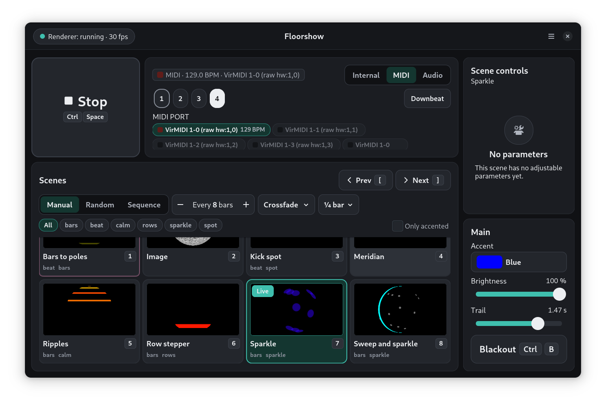
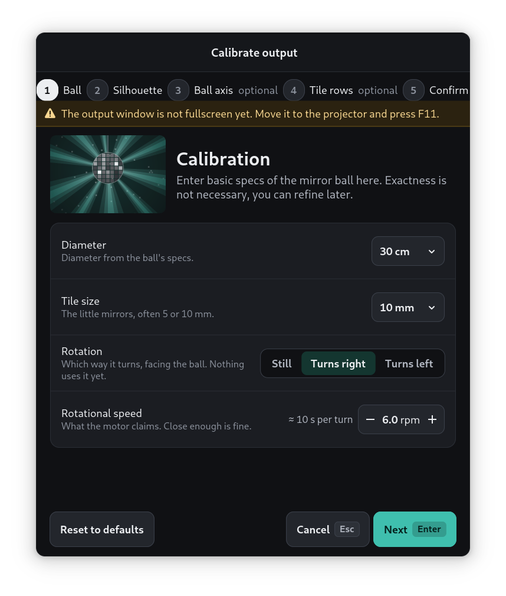
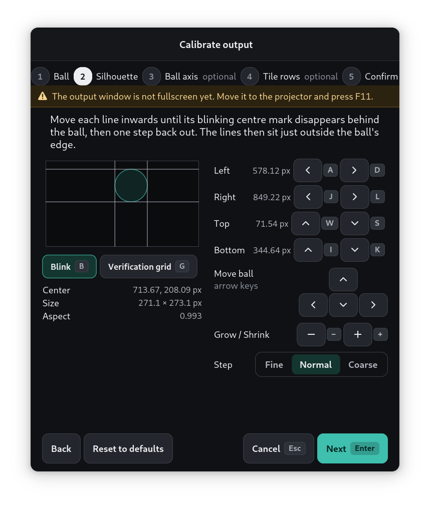
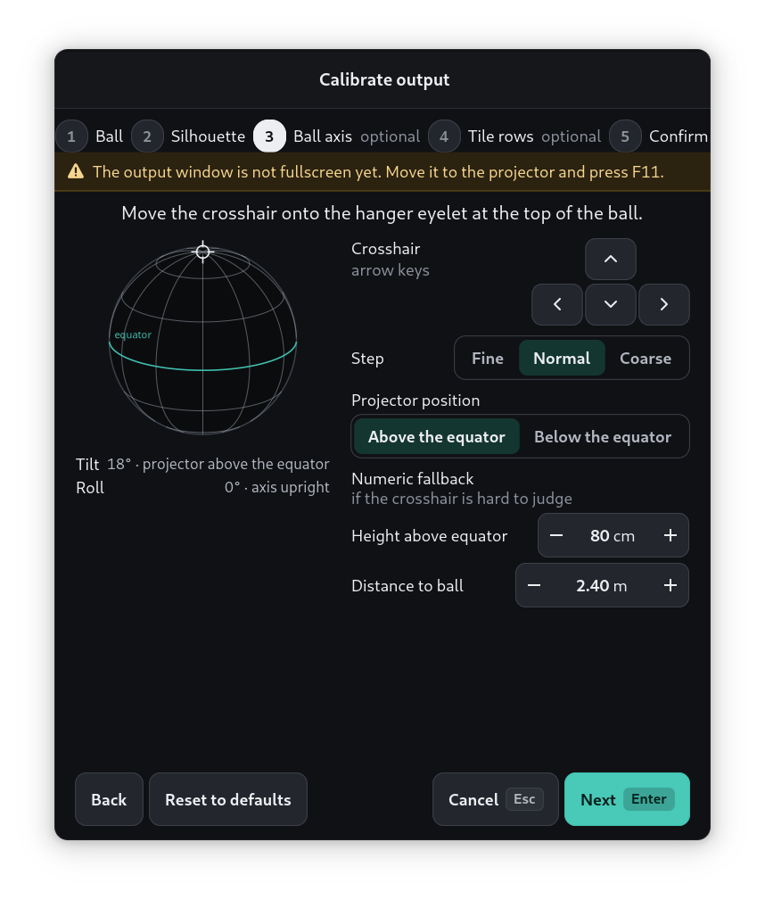
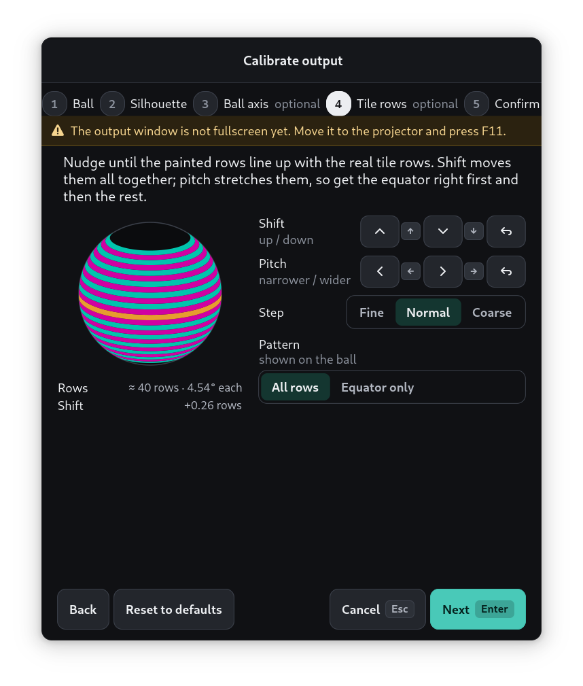

# floorshow

Floorshow drives a video projector aimed at a disco mirror ball. Bands, rings and spots are mapped onto the calibrated sphere so they land on the ball, follow the music's beat and leave the rest of the room dark. One operator runs the show from a laptop while the projector shows only the ball's light.

## Features

- **Flexible beat detection.** Takes the beat from audio (e.g. your DJ software on the same laptop, or line in), MIDI clock, MIDI beat notes (e.g. Mixxx) or tap tempo. One key marks the bar's "1".
- **Scenes are YAML files.** Scenes are short YAML files with expressions over the beat, bar and other variables. Examples included.
- **Select scenes automatically or manually.** Pick scenes yourself during the show, or let the app change them every few bars, at random or in sequence, with crossfades, wipes, irises or flashes.
- **Live controls.** Blackout, brightness, a fading trail, scene parameters and an accent colour for the whole show. 
- **Haze simulation during scene development.** Switch on a beam reflection simulation when developing scenes on your couch.
- **Simple calibration.** A calibration wizard lets you fit the image to the ball in a few steps.
- **Hard to crash.** The output runs on its own: closing or crashing the control window, or a broken audio setup, doesn't stop the show. The screen doesn't blank mid-set.
- **Scriptable.** `floorshow-ctl` controls a running show from a shell: scene, mode, master, trail, simulation, parameters, state, and a live event stream (`watch`).

Not built yet: the motor that turns the ball.


*The output window, as the projector sends it: spots mapped onto the calibrated ball, everything else dark.*


*The haze simulation: the beams the mirror tiles throw into the room, here while the accent colour changes.*



*The controller: start and stop, the beat clock and its source, the scene cards with their previews, scene controls and the main controls.*

<table>
  <tr>
    <td><a href="docs/media/calibration-1.png"></a></td>
    <td><a href="docs/media/calibration-2.png"></a></td>
    <td><a href="docs/media/calibration-3.png"></a></td>
    <td><a href="docs/media/calibration-4.png"></a></td>
  </tr>
  <tr>
    <td><em>1. The ball: size, tiles and rotation.</em></td>
    <td><em>2. The silhouette: lines framing the ball in the projector image.</em></td>
    <td><em>3. The axis: crosshair on the hanger eyelet.</em></td>
    <td><em>4. The tile rows, lined up with the real ones.</em></td>
  </tr>
</table>

*The calibration wizard. Click an image to enlarge it.*

## Installation

Needs Linux with GNOME (or another GTK4 desktop), Python 3.13 and [uv](https://docs.astral.sh/uv/). The controller needs these system packages:

```bash
sudo apt install gir1.2-gtk-4.0 gir1.2-adw-1 libgirepository-2.0-dev libcairo2-dev pkg-config
```

Beat detection on audio needs PipeWire and these GStreamer packages:

```bash
sudo apt install gstreamer1.0-pipewire gstreamer1.0-plugins-base gstreamer1.0-plugins-good gstreamer1.0-plugins-bad gir1.2-gstreamer-1.0 gir1.2-gst-plugins-base-1.0
```

Then, in the repository:

```bash
uv sync --extra render --extra control --extra audio
```

```bash
uv run floorshow
```

**Start** in the controller launches the renderer if it isn't already running. Move the output window to the projector (Super+Shift+←/→) and press **F11** in it. Run **Calibration** from the menu every time you set up the rig.

For the audio clock, choose **Audio** in the clock strip and pick the source beside Downbeat. **Preferences › Clock › Audio** holds the tempo range it looks in (drum and bass at 174 reads as 87 unless the slowest tempo is above 87) and an audio offset, added to the beat offset to cancel the delay of the sound path. `uv run floorshow-listen --list` lists the sources, and `--watch` shows their levels and the first one's tempo once a second, without the rest of the app.

Config lives in `~/.config/floorshow/config.yaml`, your scenes in `~/.config/floorshow/scenes/*.yaml`. Both reload while the app runs. Scene previews are cached in `~/.cache/floorshow/previews/`. To write scenes, see [docs/scenes-tutorial.md](docs/scenes-tutorial.md) and [docs/scenes-reference.md](docs/scenes-reference.md).

## Development

[mise](https://mise.jdx.dev/) pins Python and uv (`mise.toml`). Install dependencies as above. Then:

```bash
uv run --extra render --extra control --extra audio pytest
```

This runs the tests visibly: the controller's GTK tests open their windows on your desktop and take focus while they run, so you can watch them but not use the desktop. The GL tests use a standalone EGL context and need no display; the GTK tests need one and skip without it.

To run everything in the background instead, run the tests against a private headless GNOME Shell (GNOME 48 or later). Nothing appears on your screen, and arguments go to pytest:

```bash
tools/test-headless.sh
```

```bash
tools/test-headless.sh tests/test_z_control_gtk.py -x
```

`test_inhibit` skips there, since it needs a real GNOME session. Without GNOME Shell, GTK's Broadway backend (from `libgtk-4-bin`) also keeps the windows off the desktop:

```bash
gtk4-broadwayd :7 &
```

```bash
env -u DISPLAY -u WAYLAND_DISPLAY GDK_BACKEND=broadway BROADWAY_DISPLAY=:7 uv run --extra render --extra control --extra audio pytest
```

Helpers in `tools/`:

- `midi_clock.py --bpm 128 [--beat-notes]` fakes a MIDI clock or Mixxx-style beat notes.
- `beat_bench.py` scores beat trackers on what the projector would show: `synth` writes clips with exact beats, `run` benchmarks (precision, share of beats in time, lock time after tempo changes, cost per source), `annotate` makes reference beats for real recordings with Beat This!, `micify` makes a simulated-microphone copy. Clips live in `~/.cache/floorshow/beat-clips/`.
- `audio_spike.py` measures capture through PipeWire (timestamps, jitter, lost audio, CPU) and can record WAV clips for the benchmark.
- `screenshot_ui.py` and `screenshot_dialogs.py` render the windows in each design state.
- `swap_stall_repro.py` compares frame-loop structures.

The renderer logs to `~/.local/state/floorshow/` (`render.log`, plus `render.stacks` on a stall or after `kill -USR1 <pid>`). The audio listener's messages go into `render.log` too.

`docs/design-brief.md` is the UI brief and `docs/design/` holds the UI design boards and their generator. [docs/adr/](docs/adr/README.md) records the architecture decisions and the evidence behind them.

## How it works

- **Renderer.** Everything that makes the show happens here: the beat clock, the director (which scene runs and how it transitions), the scene library, config hot-reload and calibration mode. This core has no GL, window or device code, so it can be tested with simulated time. Around it, the main thread only handles window events, a separate thread renders and presents frames, and MIDI input, the audio listener and the control socket feed a single inbox.
- **GPU pipeline.** Each shape reduces to one primitive: a center direction on the ball with an inner and outer angular radius. A fragment shader maps each pixel through the calibrated silhouette to a direction on the ball and evaluates all shapes there. Later passes blend the two scenes of a transition and add the trail, then apply master brightness and the calibration overlay. Because those come after the trail, blackout is instant and calibration lines don't smear. Python only uploads a few numbers per shape per frame.
- **Beat detection.** `floorshow-listen` runs as a child of the renderer, only while the audio clock drives the show (its analysis never competes with the frame loop, and a broken audio stack can't take the show down). It captures through GStreamer's PipeWire source, one pipeline per source. The chosen source's samples go to a causal beat tracker: onsets from multi-band spectral flux, tempo from their autocorrelation, and beat phase from folding them at the beat period. A flip to the off-beat needs kick evidence that builds up, so hats and bass on the off-beat don't take the beat over. Every other source is only metered, inside GStreamer. Capture times come from a fit of arrival times against the sample count, which follows the sound card's drift against the system clock. Ten times a second the tracker's beat goes to the renderer, whose clock takes its phase and tempo but keeps its own bar position.
- **Scenes.** YAML is validated into a model, and every error in a file is reported at once. Expressions use a small whitelisted language, so scene files can be shared safely. They are compiled once and evaluated every frame.
- **Controller.** A thin remote. It shows the state the renderer streams to it and sends commands back. It is the only process that writes `config.yaml` (the renderer just reloads it), and it reads the scene files itself, so it still works offline. Its logic is kept apart from GTK so it can be tested.
- **Protocol.** JSON Lines over a Unix socket: requests with replies, plus events the renderer sends unprompted. The controller and `floorshow-ctl` both use it.
